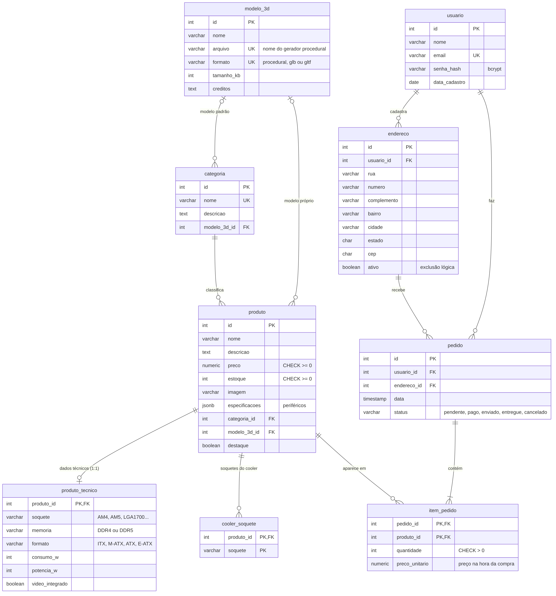
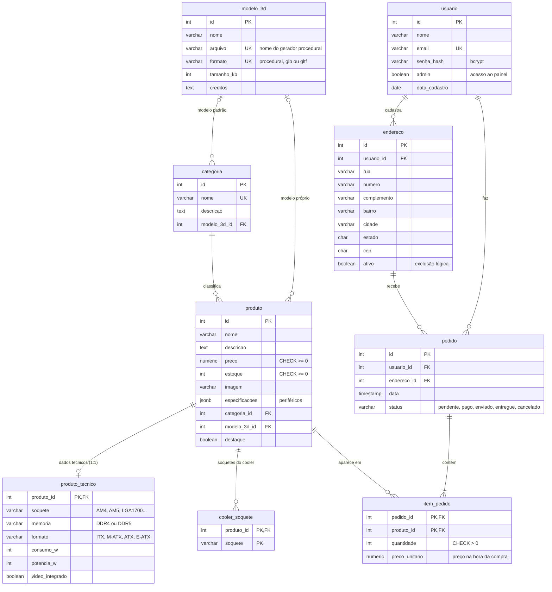

# PC Store: e-commerce de peças de PC

Projeto das disciplinas de **Banco de Dados** e **Computação Gráfica**: uma loja de peças de PC e periféricos em que cada produto tem uma prévia 3D gerada por código (Three.js), e um "Monte seu PC" que só mostra peças compatíveis e anima a montagem em 3D.

**Site:** [e-commerce-trabalho.vercel.app](https://e-commerce-trabalho.vercel.app)

## Funcionalidades

- **Catálogo** com cerca de 238 produtos em 15 categorias, busca, filtro por categoria e vitrine de destaques no banner.
- **Página do produto** com abas Foto e 3D, tela cheia, girar e aproximar, e "Ver por dentro" (vista explodida, tocar numa parte mostra o nome dela).
- **Monte seu PC**: 15 passos opcionais e uma revisão. Cada passo só mostra as peças compatíveis com as já escolhidas (soquete, tipo de memória, tamanho da placa, potência da fonte e soquetes do cooler). A animação 3D encaixa as peças no gabinete e coloca os periféricos na mesa. No fim, adiciona tudo ao carrinho.
- **Carrinho, checkout, login e cadastro** (JWT), **conta** com endereços (busca pelo CEP) e pedidos, com cancelamento que devolve as unidades ao estoque.
- **Painel do administrador** (`admin.html`, só para contas com `admin = TRUE`): resumo da loja, todos os pedidos com mudança de status (pendente → pago → enviado → entregue, ou cancelado devolvendo o estoque), cadastro, edição, destaque e exclusão de produtos, e cadastro de categorias.

## Tecnologias

| Parte    | Tecnologia                                        | Hospedagem |
|----------|---------------------------------------------------|------------|
| Banco    | PostgreSQL                                        | Supabase   |
| Backend  | Node.js + Express, `pg`, `bcrypt`, `jsonwebtoken` | Render     |
| Frontend | Vite + JavaScript puro, Three.js                  | Vercel     |

## Estrutura

```
ecommerce-pc-main/
├── database/        scripts SQL (criação, dados e migrações)
├── backend/src/
│   ├── server.js    configura o Express e as rotas
│   ├── db.js        conexão com o banco (pool)
│   ├── middleware/  auth.js: exige login (token JWT) e exige administrador
│   └── routes/      produtos, categorias, auth, enderecos, pedidos, admin
├── frontend/
│   ├── *.html       uma página por tela
│   ├── public/      fotos próprias dos produtos personalizados
│   └── src/
│       ├── pages/       um arquivo JS por tela
│       ├── componentes/ cabeçalho, cartão do produto, endereço...
│       └── viewer/      tudo do 3D (ver "Computação Gráfica")
└── docs/            diagrama do banco (DER)
```

## Como rodar no seu computador

Precisa de **Node.js 22** (ou 20.19+) e **PostgreSQL**.

### 1. Banco

Crie um banco vazio chamado `ecommerce_pc` e rode os scripts da pasta `database/` **nesta ordem** (pelo terminal ou pelo Query Tool do pgAdmin):

```bash
cd database
psql -U postgres -d ecommerce_pc -f schema.sql
psql -U postgres -d ecommerce_pc -f seed.sql
psql -U postgres -d ecommerce_pc -f migracao-01-endereco.sql
psql -U postgres -d ecommerce_pc -f migracao-02-placas-de-video.sql
psql -U postgres -d ecommerce_pc -f migracao-03-placas-mae-e-processadores.sql
psql -U postgres -d ecommerce_pc -f migracao-04-monte-seu-pc.sql
psql -U postgres -d ecommerce_pc -f migracao-05-modelos-3d.sql
psql -U postgres -d ecommerce_pc -f migracao-06-perifericos.sql
psql -U postgres -d ecommerce_pc -f migracao-07-sem-modelos-baixados.sql
psql -U postgres -d ecommerce_pc -f migracao-08-modelos-fieis.sql
psql -U postgres -d ecommerce_pc -f migracao-09-destaques.sql
psql -U postgres -d ecommerce_pc -f migracao-10-administrador.sql
psql -U postgres -d ecommerce_pc -f migracao-11-modelos-sketchfab.sql
```

Para usar o painel do administrador, cadastre-se no site e depois marque a sua conta como administradora (troque pelo seu e-mail):

```sql
UPDATE usuario SET admin = TRUE WHERE email = 'seu-email@exemplo.com';
```

Saia e entre de novo no site: o link **Painel** aparece no cabeçalho.

- `schema.sql` cria as tabelas e `seed.sql` coloca os primeiros dados. **Os dois apagam tudo o que já existe**, então só servem para começar do zero.
- As **migrações** acrescentam o resto (produtos, categorias, dados técnicos, modelos 3D, destaques). Todas podem ser rodadas mais de uma vez sem duplicar nada. Sem elas o backend não funciona, porque ele usa colunas criadas nas migrações (por exemplo `destaque`, da migração 09).
- No final o banco fica com 238 produtos, 15 categorias e 13 produtos em destaque.

### 2. Backend (porta 3000)

```bash
cd backend
cp .env.example .env    # preencha DB_PASSWORD e JWT_SECRET
npm install
npm run dev
```

Teste em http://localhost:3000/api/saude.

### 3. Frontend (porta 5173)

```bash
cd frontend
npm install
npm run dev
```

Abra http://localhost:5173. O Vite repassa as chamadas `/api` para o backend (ver `frontend/vite.config.js`).

## Versão online

| Serviço  | O que configurar |
|----------|------------------|
| Supabase | Rode no SQL Editor os mesmos scripts da seção "Banco", na mesma ordem, e por último `database/supabase-seguranca.sql` (liga o RLS e bloqueia a API pública automática do Supabase). **Depois do banco criado, nunca rode `schema.sql` ou `seed.sql` de novo**: mudanças novas entram sempre como uma migração nova (`migracao-11-...`). |
| Render   | Pasta raiz `backend`, comando `npm start`. Variáveis: `DATABASE_URL` (endereço de conexão do Supabase), `JWT_SECRET` e, se quiser, `JWT_EXPIRA_EM`. |
| Vercel   | Pasta raiz `frontend`, comando `npm run build`, saída `dist`. Variável: `VITE_API_URL` com o endereço do backend no Render (ex.: `https://meu-backend.onrender.com`). |

## Banco de dados



O mesmo diagrama em texto (o GitHub desenha sozinho) está em [`docs/der.mmd`](docs/der.mmd).



### Pontos principais

- **Relações 1:N:** categoria → produto, usuário → endereço, usuário → pedido, endereço → pedido.
- **Relação 1:1:** `produto_tecnico` guarda soquete, memória, formato, consumo e potência. Só as peças que têm esses dados ganham uma linha (um mouse, por exemplo, não tem).
- **Relações N:N:** `item_pedido` (pedido × produto, com chave primária composta) e `cooler_soquete` (os soquetes que cada cooler aceita).
- **JSONB:** `produto.especificacoes` guarda características que mudam de categoria para categoria (polegadas do monitor, formato do teclado, cores da cadeira...), sem precisar de uma coluna para cada uma.
- **View `vw_produto_catalogo`:** junta produto, categoria, modelo 3D e dados técnicos. Escolhe o modelo 3D com `COALESCE` (primeiro o do produto, depois o da categoria) e junta os soquetes do cooler com uma subconsulta correlacionada e `array_agg`.
- **Transação no pedido:** o pedido é criado numa transação que trava cada produto com `SELECT ... FOR UPDATE`, confere o estoque e o diminui. Os produtos são travados sempre em ordem de id, para evitar deadlock. O cancelamento também é uma transação: muda o status e devolve as unidades ao estoque.
- **Histórico de preço:** `item_pedido.preco_unitario` guarda o preço do momento da compra, então mudar o preço do produto não altera pedidos antigos.
- **Administrador:** `usuario.admin` diz quem pode usar o painel. O backend confere essa coluna no banco a cada requisição de `/api/admin` (e não só no token), então tirar o admin de alguém vale na hora. A mudança de status do pedido também é uma transação com `FOR UPDATE`, e só aceita os próximos passos válidos.
- **Exclusão lógica:** um endereço já usado em pedido não é apagado, só fica `ativo = FALSE`. Assim o histórico continua certo.
- **Integridade:** `CHECK` em preço, estoque, quantidade, status, tipo de memória e formato, além de `UNIQUE` no e-mail e nos nomes de categoria e de índices nas chaves estrangeiras.
- **Segurança:** as senhas são guardadas com hash `bcrypt`, e o RLS fica ligado no Supabase.

## Computação Gráfica

Os modelos 3D são **gerados por código** com Three.js (em milímetros). A tabela `modelo_3d` guarda o nome do gerador de cada categoria, e a view escolhe qual usar. A exceção é a página do produto de placas de vídeo, processadores e gabinetes, que mostra um modelo baixado do Sketchfab (`.glb` em `frontend/public/modelos`, migração 11). Os produtos com modelo fiel e o Monte seu PC continuam com os modelos gerados por código, e se o `.glb` faltar a página volta para eles.

| Arquivo (`frontend/src/viewer/`) | O que faz |
|---|---|
| `viewer.js` | Visualizador: câmera, luzes, girar e aproximar, tela cheia e vista explodida ("Ver por dentro") |
| `modelos-procedurais.js`, `modelos-pc.js`, `modelos-perifericos.js` | Modelo genérico de cada uma das 15 categorias |
| `parametros.js` | Modelagem paramétrica: lê o nome e os dados do produto (número de ventoinhas, tamanho, formato, cor...) e ajusta o modelo genérico |
| `especificos-pc.js`, `especificos-perifericos.js` | 13 modelos fiéis, feitos a partir de fotos dos produtos em destaque |
| `bancada3d.js` | Animação do Monte seu PC: as peças encaixam no gabinete e os periféricos vão para a mesa |
| `util3d.js` | Funções de apoio: caixas, extrusões e texturas desenhadas em canvas |

As técnicas usadas incluem formas extrudadas, `InstancedMesh` para pinos e contatos repetidos, texturas desenhadas em canvas e animação das ventoinhas e da montagem.

## API

| Rota | Descrição |
|------|-----------|
| `GET /api/saude` | testa se o backend está no ar |
| `GET /api/produtos` | lista produtos (`?categoria=1`, `?busca=rtx`), na ordem: destaques, com foto e o resto |
| `GET /api/produtos/:id` | um produto, com `modelo_3d` e `tecnico` |
| `GET /api/categorias` | categorias com a quantidade de produtos |
| `POST /api/auth/cadastro` e `POST /api/auth/login` | cadastro e login (devolvem o token JWT) |
| `GET /api/auth/eu` | usuário logado |
| `GET /api/enderecos` e `POST /api/enderecos` | lista e cadastra endereços do usuário logado |
| `PUT /api/enderecos/:id` e `DELETE /api/enderecos/:id` | edita e exclui um endereço (exclusão lógica se já foi usado num pedido) |
| `GET /api/pedidos` e `POST /api/pedidos` | lista os pedidos e cria um pedido (transação com `FOR UPDATE`) |
| `POST /api/pedidos/:id/cancelar` | cancela um pedido e devolve o estoque |
| `GET /api/admin/resumo` | números do painel: pedidos por status, faturamento, produtos sem estoque |
| `GET /api/admin/pedidos` | todos os pedidos, com cliente (`?status=pendente`) |
| `PATCH /api/admin/pedidos/:id/status` | muda o status (`{ "status": "enviado" }`); cancelar devolve o estoque |
| `GET /api/admin/produtos` e `POST /api/admin/produtos` | lista e cadastra produtos |
| `PUT /api/admin/produtos/:id` e `DELETE /api/admin/produtos/:id` | edita e exclui um produto (só se nunca foi vendido) |
| `PATCH /api/admin/produtos/:id/destaque` | liga ou desliga o destaque |
| `POST`, `PUT` e `DELETE /api/admin/categorias` | cadastra, edita e exclui categorias (só se estiver vazia) |

As rotas `/api/admin` exigem um usuário com `admin = TRUE` (senão respondem 403).
As rotas de endereços, pedidos e `/auth/eu` exigem o cabeçalho `Authorization: Bearer <token>`.

## Equipe

- Murilo Pacheco
- Giovanni Oliveira
- Vinicyus Rodrigues
- Italo Silva Lira
- Pierre Silva de Sá
- Guilherme Augusto

## Fontes dos dados

Este é um trabalho acadêmico, sem fins comerciais: nenhum produto é vendido de verdade.

- **Pichau** ([pichau.com.br](https://www.pichau.com.br)): nomes, preços à vista e fotos dos produtos, consultados em 08/10/2026 só como referência. A maioria das fotos aponta para o endereço original no site da Pichau.
- **KaBuM** ([kabum.com.br](https://www.kabum.com.br)): fotos dos 13 produtos em destaque, usadas para fazer os modelos 3D fiéis. Ficam em `frontend/public/imagens/kabum`.
- **Modelos 3D do Sketchfab** (licença [CC BY 4.0](http://creativecommons.org/licenses/by/4.0/)). O crédito também aparece na página de cada produto e fica na coluna `creditos` da tabela `modelo_3d`:
  - Placa de vídeo: ["GeForce RTX 3080 Graphics Card"](https://sketchfab.com/3d-models/geforce-rtx-3080-graphics-card-8b947ee1bf7a4e3d8ffa1c24893ac160), por _surovic_ (@samuelsurovic)
  - Processador: ["AMD Ryzen 5 5600X Processor"](https://sketchfab.com/3d-models/amd-ryzen-5-5600x-processor-1649601de2014dbeab4f201010a7c366), por PolyDavid
  - Gabinete: ["Gaming PC Case"](https://sketchfab.com/3d-models/gaming-pc-case-5f9261fef2874bf9ae39dd0f4029e978), por dylanheyes

Os estoques são fictícios. O site mostra a fonte embaixo de cada foto e repete este aviso no rodapé.

As marcas, nomes de produtos e imagens pertencem aos seus respectivos donos. Se algum detentor de direitos pedir, o conteúdo é retirado.
